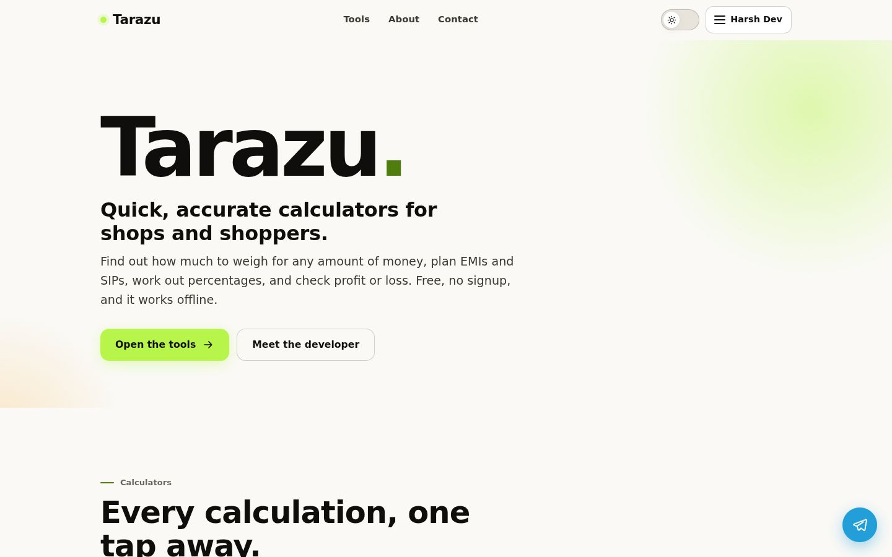
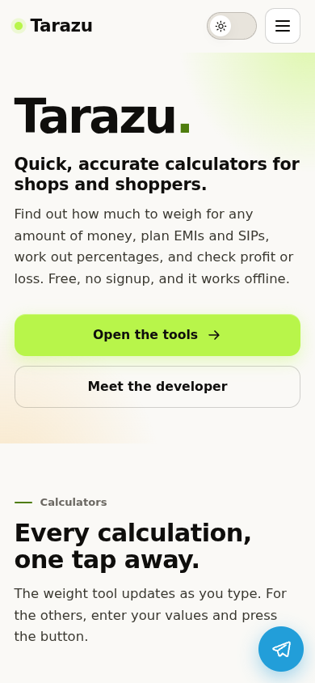
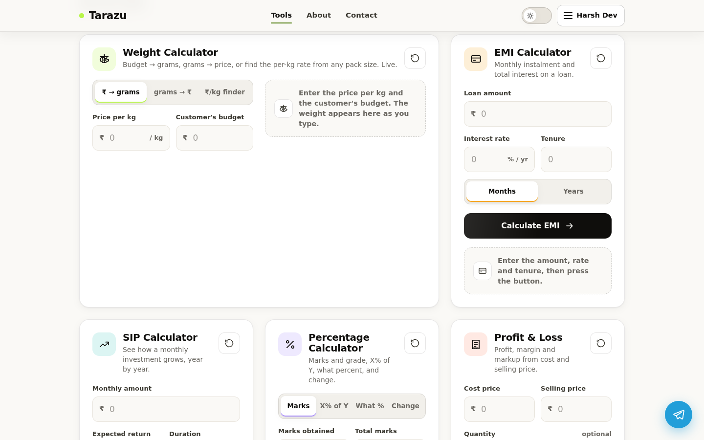
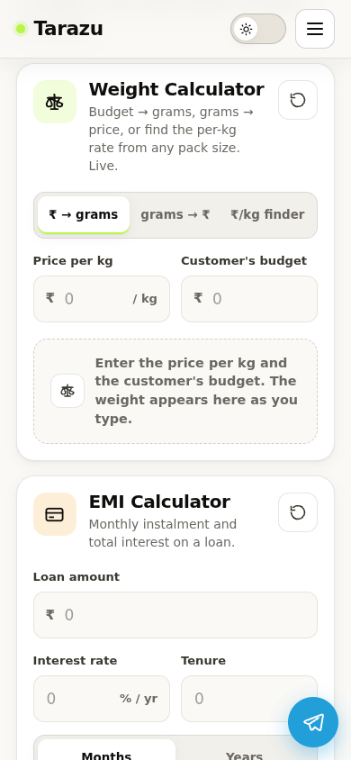

<p align="center">
  
</p>

<h1 align="center">Tarazu</h1>

<p align="center"><strong>Quick, accurate calculators for shops and shoppers.</strong><br>No signup, no ads — just type the numbers and get the answer.</p>

---

## Preview

### Landing page

<p align="center">
  
</p>
<p align="center"><em>Desktop</em></p>

<p align="center">
  
</p>
<p align="center"><em>Mobile</em></p>

### Tools — desktop + mobile together

<table>
  <tr>
    <td align="center" width="68%">
      <br>
      <em>Desktop · 3-mode weight card + other tools</em>
    </td>
    <td align="center" width="32%">
      <br>
      <em>Mobile · same tabs, touch-friendly</em>
    </td>
  </tr>
</table>

---

## What it does

Tarazu is a single-page, dependency-free web app with five live calculators. It remembers your theme and language, animates results, lets you copy any answer, and works without an internet connection once loaded.

### ⚖️ Weight Calculator — now with 3 modes

The shopkeeper's favourite, inside one card with tabs:

| Tab | You enter | You get |
| --- | --- | --- |
| **₹ → grams** | Price per kg + customer's budget | How many grams to give (with kg equivalent) |
| **grams → ₹** | Price per kg + grams needed | The exact price for that weight — e.g. ₹70/kg × 250 g = **₹17.50** |
| **₹/kg finder** | Price paid + grams received | The real rate — e.g. ₹70 for 250 g = **₹0.28/g** and **₹280/kg** |

Every mode also shows **₹/gram and ₹/kg**, updates while you type, validates inputs, and supports copy-to-clipboard.

### Other tools

- 💳 **EMI** — monthly instalment, total interest and total payable; months or years.
- 📈 **SIP** — invested amount, estimated returns and year-by-year growth bars.
- 📊 **Percentage** — marks → grade, X% of Y, "X is what % of Y", and increase/decrease.
- 💰 **Profit & Loss** — net profit/loss, margin, markup, with optional quantity.

---

## Live Telegram activity bot

Every page visit and every calculator result sends a compact alert to Telegram through a Netlify Function:

```text
⚡ TARAZU · TOOL USED

━━━━━━━━━━━━━━━━━━━━

🔍 WHAT WAS SEARCHED
├ Tool: Weight Calculator
├ Search: Price per kg: 70 · Customer's budget: 15
├ Answer: 375 g
└ By: Desktop · 🖥️ · Chrome 131 · 195.96.134.176

📍 LOCATION & NETWORK
├ IP: 195.96.134.176
├ ISP: Cox Communications Inc.
├ Where: Virginia Beach, Virginia, United States
└ Net: WIFI · 50 Mbps down · 20 ms RTT

📱 DEVICE DETAILS
├ Device: Desktop 🖥️
├ OS: Linux 🐧
├ Browser: Chrome 131
├ Battery: 🔋 72% · charging ⚡
└ Timezone: America/New_York

🇮🇳 IST: 25 Nov 2026, 2:37:28 pm
━━━━ ━━━━━━━━━━━━━━━━
Tarazu Bot · built for Harsh ✨
```

- The bot token **never** reaches the browser.
- ISP, ASN and approximate location come from the visitor's public IP via `ipwho.is` (free, cached 30 minutes).
- Battery/Browser/Network details come from browser APIs where supported; unsupported browsers report `Not exposed by browser`.
- Alerts are throttled: one visit per 10 minutes and one alert per tool per 45 seconds per tab.

### Style details

- **Bold everything important** — labels and values use Telegram `<b>`; the raw search query and IP use monospace `<code>`.
- **"By:" line** — the search section names *who* searched (device, browser and IP) right next to *what* they searched.
- **Activity-report layout** — section emojis (🔍 📍 📱 🇮🇳), `├ / └` tree connectors and separator rules.
- **Device chips** — 🖥️ desktop, 📱 mobile, 📟 tablet, 🐧 Linux, 🤖 Android, 🍎 Apple, plus 🔋 for battery.
- **Inline action** — every alert ends with an "Open Tarazu ↗" button.

### Environment variables

Set these in Netlify → Site configuration → Environment variables, then redeploy:

| Variable | Example | Purpose |
| --- | --- | --- |
| `TELEGRAM_BOT_TOKEN` | `123456:AA...` | Token from [@BotFather](https://t.me/BotFather) — required |
| `TELEGRAM_CHAT_ID` | `@pmharsh` | Destination chat/channel (defaults to `@pmharsh`) |
| `ALLOWED_ORIGINS` | `https://mysite.example` | Optional extra origins, comma-separated |

---

## Run locally

```bash
python3 -m http.server 4173
# open http://localhost:4173
```

For the Telegram function locally, use `netlify dev` with the same variables in a `.env` file.

## Tests

```bash
node --test tests/*.test.js
```

No third-party packages are required. The tests cover the Telegram message formatting/validation and all three weight-calculator modes.

## Project structure

```text
index.html                     whole app: markup, styles, calculators, UI, notifier
icons/icon.svg                 Tarazu logo / favicon
docs/screenshots/              desktop + mobile preview images
netlify/functions/
  visitor-ping.js              ISP lookup + Telegram alert formatting/delivery
netlify.toml                   functions directory config
tests/
  visitor-ping.test.js         notification bot tests
  weight.test.js               three weight modes + validation tests
```

---

<p align="center">Built by <a href="https://github.com/Dev-Harshupadhyay">Harsh Upadhyay</a> · <a href="https://t.me/pmharsh">@pmharsh</a> · <a href="https://github.com/Dev-Harshupadhyay/Tarzau-">GitHub repo</a></p>
